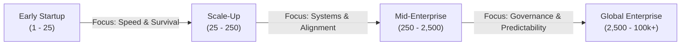
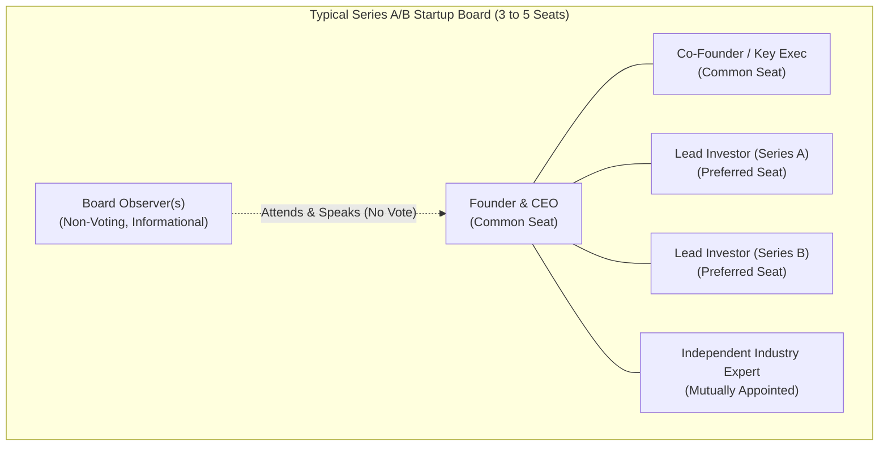
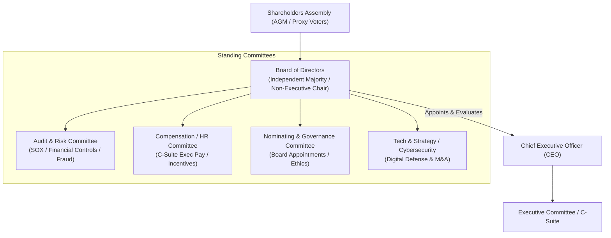
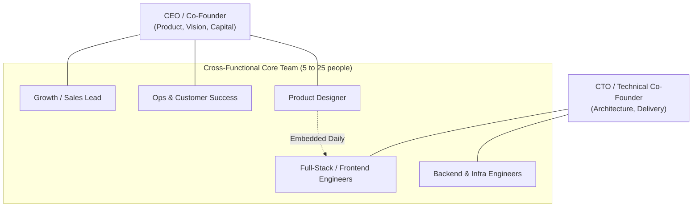
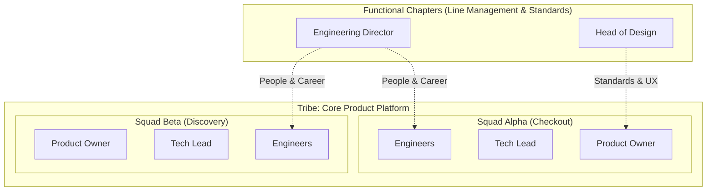
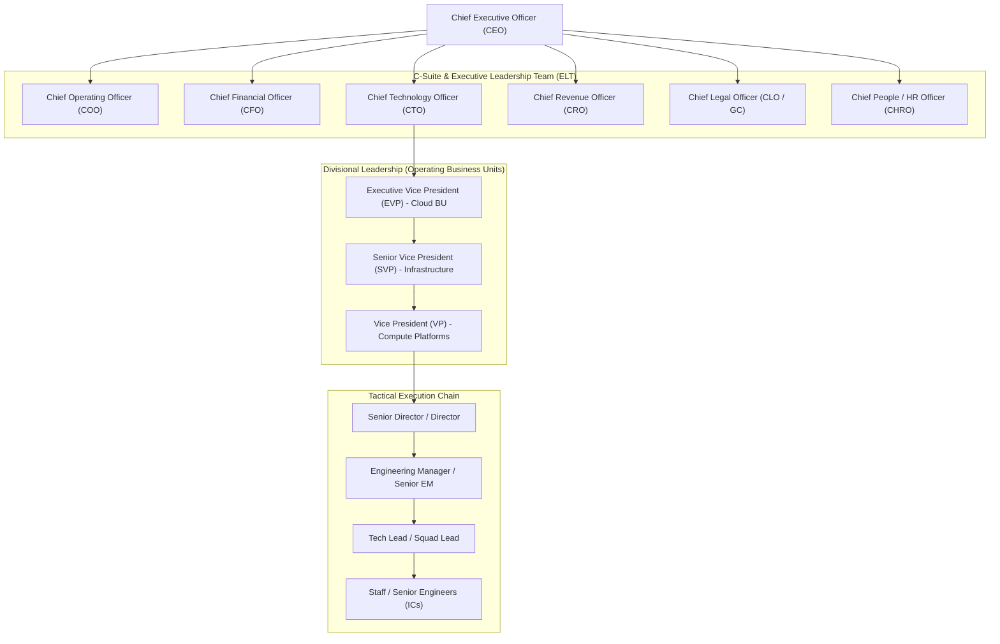
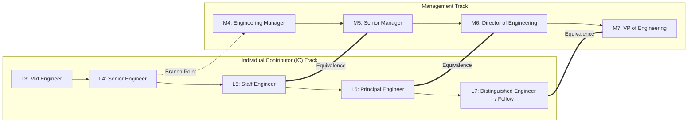
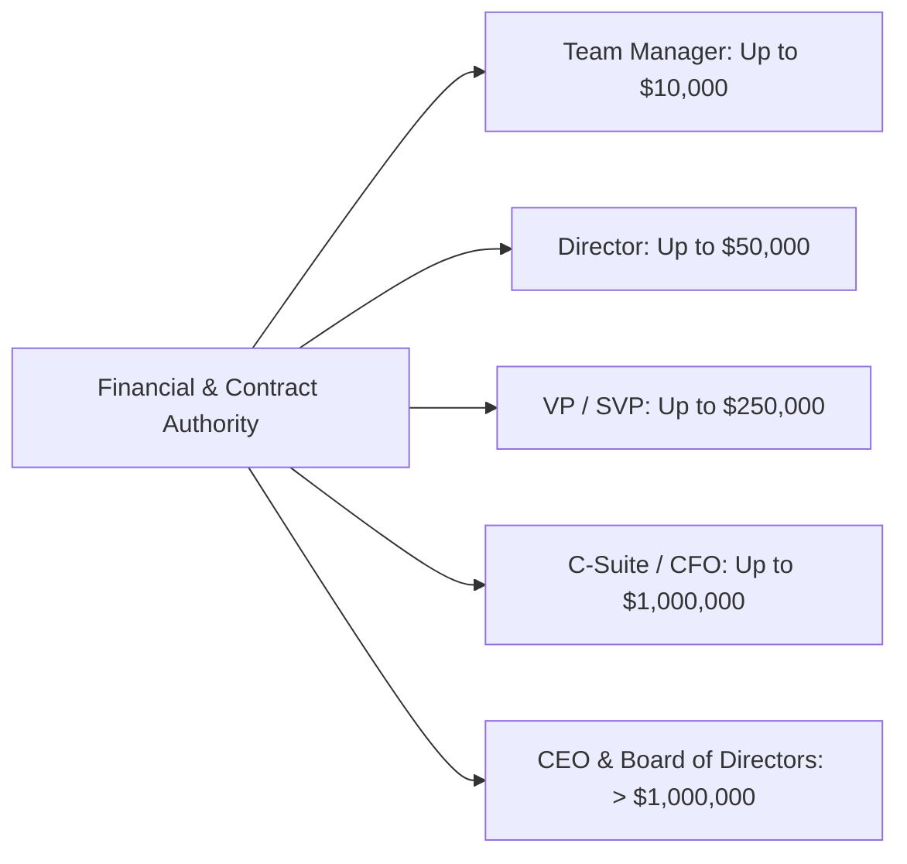
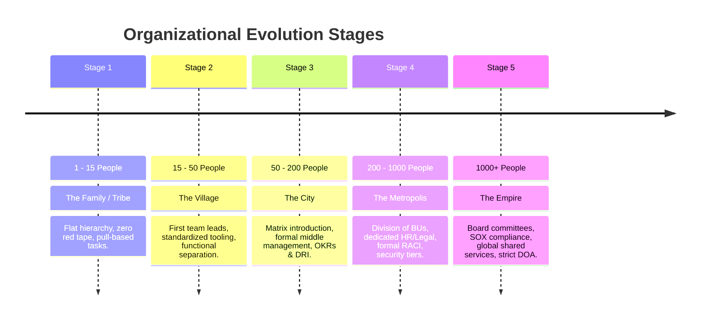

# Organizational Governance, Hierarchy & Task Assignment Framework
### A Comprehensive Reference: Startup vs. Enterprise Ecosystems

---

## 📑 Table of Contents
1. [Executive Summary & Core Principles](#1-executive-summary--core-principles)
2. [Board Structure & Corporate Governance](#2-board-structure--corporate-governance)
   - [2.1 Startup Board of Directors (Seed to Series C)](#21-startup-board-of-directors-seed-to-series-c)
   - [2.2 Enterprise / Fortune 500 Board Architecture](#22-enterprise--fortune-500-board-architecture)
   - [2.3 Board Governance & Fiduciary Duties](#23-board-governance--fiduciary-duties)
3. [Chain of Command & Reporting Architectures](#3-chain-of-command--reporting-architectures)
   - [3.1 Startup Chain of Command (Flat & Pod-Based)](#31-startup-chain-of-command-flat--pod-based)
   - [3.2 Scale-Up Matrix (Squads, Chapters, Guilds)](#32-scale-up-matrix-squads-chapters-guilds)
   - [3.3 Massive Enterprise Multi-Tiered Hierarchy](#33-massive-enterprise-multi-tiered-hierarchy)
   - [3.4 Dual-Track Career Topology (Management vs. IC)](#34-dual-track-career-topology-management-vs-ic)
4. [Task Assignment, Delegation & Accountability Models](#4-task-assignment-delegation--accountability-models)
   - [4.1 The DRI (Directly Responsible Individual) Model](#41-the-dri-directly-responsible-individual-model)
   - [4.2 Amazon Single-Threaded Ownership & Two-Pizza Teams](#42-amazon-single-threaded-ownership--two-pizza-teams)
   - [4.3 RACI, DACI & RAPID Assignment Matrices](#43-raci-daci--rapid-assignment-matrices)
   - [4.4 Delegation of Authority (DOA) & Financial Thresholds](#44-delegation-of-authority-doa--financial-thresholds)
   - [4.5 Escalation Paths & Decision Speed Protocols](#45-escalation-paths--decision-speed-protocols)
5. [Side-by-Side Comparative Matrix](#5-side-by-side-comparative-matrix)
6. [Organizational Transition Playbook (Scaling Tiers)](#6-organizational-transition-playbook-scaling-tiers)
7. [Governance Anti-Patterns & Pitfalls](#7-governance-anti-patterns--pitfalls)

---

## 1. Executive Summary & Core Principles

Organizations scale along an axis between **Execution Speed / Agility** (Startups) and **Risk Management / Scale Continuity** (Enterprises). A failure to adapt corporate governance, reporting chains, and task allocation rules to an organization's maturity stage leads to either:
- **Startup Gridlock**: Too many rules, premature corporate layers, slow consensus, and loss of momentum.
- **Enterprise Chaos**: Shadow decision-making, unvetted commitments, compliance/fiduciary violations, and operational collisions.



---

## 2. Board Structure & Corporate Governance

The Board of Directors (BoD) sits at the summit of legal authority, representing the ultimate corporate stewards who represent the interest of shareholders and ensure institutional survival.

### 2.1 Startup Board of Directors (Seed to Series C)

In an early-stage startup, the board balances investor oversight with founder autonomy. It is lean, focused on runway, product-market fit, and fundraising.



#### Composition & Voting Dynamics
- **Seed Stage (2–3 Seats)**: Typically 2 Founders + 1 Lead Angel / Seed Fund Lead, or 2 Founders alone with advisory check-ins.
- **Series A (3–5 Seats)**: 2 Founders (Common), 1 Lead VC (Preferred Series A), 1 Independent Industry Veteran, optional 1 Additional Seat.
- **Series B/C (5–7 Seats)**: 2 Common Seats, 2–3 Preferred VC Seats, 1–2 Independents.
- **Board Observers**: Non-voting representatives (e.g., secondary investors, legal counsel) who attend board meetings, inspect financial data, but hold zero formal vote.

#### Startup Board Responsibilities
1. **CEO Hiring, Evaluation & Replacement**: Primary legal lever of the board.
2. **Stock & Equity Allocations**: Approving the ESOP (Employee Stock Ownership Plan) pool, option grants, 409A valuations.
3. **Budget & Runway Approval**: Annual operating plan, cash burn thresholds, and financing rounds.
4. **Protective Provisions (Veto Powers)**: Preferred shareholders hold veto rights over liquidation, acquisition, major asset sales, or issuing senior debt.

---

### 2.2 Enterprise / Fortune 500 Board Architecture

In large public or multinational enterprises, the board separates strategic direction from executive operation. Members have fiduciary liabilities governed by securities regulations (e.g., SEC, Sarbanes-Oxley / SOX in the US, Corporate Governance Codes globally).



#### Key Enterprise Board Roles
| Role | Distinction & Mandate |
| :--- | :--- |
| **Chairman of the Board** | Leads board meetings, sets agenda, oversees governance. Often distinct from the CEO to eliminate conflict of interest (independent non-executive chair). |
| **Lead Independent Director** | If the CEO and Chairman are combined (CEO duality), the Lead Independent Director acts as the counterweight representing minority shareholders. |
| **Executive Directors** | Inside directors employed by the company (CEO, occasionally CFO or Founder). |
| **Non-Executive / Independent Directors** | External business leaders, former regulators, or academics with no business ties to the company. Public boards usually mandate a **majority of independent directors**. |

#### Enterprise Board Standing Committees
- **Audit Committee**: Mandatory financial experts; supervises independent auditing firms, financial statement disclosures, and internal SOX 404 risk controls.
- **Compensation & People Committee**: Sets executive compensation, performance-based LTIP (Long-Term Incentive Plans), and executive retention packages.
- **Nominating and Corporate Governance**: Identifies qualified board candidates, conducts annual self-evaluations, sets ethics and ESG policies.
- **Cybersecurity & Technology Committee**: Focuses on data breaches, AI governance, enterprise architecture resilience, and IP defense.

---

### 2.3 Board Governance & Fiduciary Duties

All board members are bound by legal doctrines:
1. **Duty of Care**: Acting in good faith, with the care an ordinarily prudent person would use in similar circumstances. Requires active preparation, inquiry, and critical diligence.
2. **Duty of Loyalty**: Subordinating personal or fund interests to the best interests of the corporation and its broader shareholder base. Prohibits self-dealing, undisclosed conflicts of interest, and stealing corporate opportunities.
3. **The Business Judgment Rule**: A presumption that in making a business decision, directors acted on an informed basis, in good faith, and in honest belief that action was in the company's best interest (protecting directors from liability for legitimate business failures).

---

## 3. Chain of Command & Reporting Architectures

### 3.1 Startup Chain of Command (Flat & Pod-Based)

Early-stage startups prioritize bandwidth, context sharing, and minimal latency.



- **Span of Control**: High (7–12 direct reports per founder).
- **Communication Protocol**: Broadcast (Slack/Discord channels, daily standup, shared digital whiteboards).
- **Decision Speed**: Hours to days. No formal approval tickets; engineers talk directly to users and push code to production.

---

### 3.2 Scale-Up Matrix (Squads, Chapters, Guilds)

As companies scale past 50–250 people, direct founder reporting breaks down (Dunbar’s Number). The Spotify / Tribe model or product-led matrix emerges.



- **Dual-Reporting in Matrix**:
  - **Operational Axis (Squad / Program)**: Day-to-day priorities, sprints, feature releases (dictated by Product Managers / Squad Leads).
  - **Functional Axis (Chapter / Discipline)**: Professional growth, compensation, engineering standards, architecture guardrails (dictated by Chapter Leads / Engineering Managers).

---

### 3.3 Massive Enterprise Multi-Tiered Hierarchy

Enterprises with 5,000 to 100,000+ employees organize via a formal multi-divisional structure (M-Form) with clear demarcation lines between business units, corporate functions, and shared services.



#### Enterprise Hierarchy Tier Table
| Level / Band | Title | Core Mandate & Horizon | Span of Control |
| :--- | :--- | :--- | :--- |
| **L9 / E-Suite** | CEO / President | Company valuation, board alignment, capital allocation (3–10 yr horizon). | 6–10 Directs |
| **L8 / EVP / C-Level** | EVP / CTO / CFO | Business Unit P&L, strategic portfolio vision (2–5 yr horizon). | 5–8 Directs |
| **L7 / SVP & VP** | Vice President | Operational strategy, resource bidding, executive risk sponsorship (1–3 yr). | 4–7 Directors |
| **L6 / Director** | Senior Director / Director | Organizational unit health, cross-functional roadmaps, OKR sign-off (6–18 mo). | 3–6 Managers |
| **L5 / Manager** | Engineering Manager (EM) | People development, performance management, velocity, delivery health (1–6 mo). | 6–10 ICs |
| **L4 / Lead** | Tech Lead / Team Lead | Technical architecture, sprint grooming, code reviews, PR audits. | 3–6 ICs |
| **L1 - L3 / IC** | Associate -> Senior IC | Hands-on execution, task delivery, unit testing, documentation. | 0 Directs |

---

### 3.4 Dual-Track Career Topology (Management vs. IC)

Mature engineering and product organizations implement a dual career ladder to retain elite technical talent without forcing them into people management.



---

## 4. Task Assignment, Delegation & Accountability Models

When tasks are assigned without crystal-clear ownership rules, operations suffer from **bystander effect**, duplication of effort, or finger-pointing.

### 4.1 The DRI (Directly Responsible Individual) Model
*Pioneered by Apple, popularized by GitLab and Silicon Valley scale-ups.*

- **Core Rule**: Every project, task, milestone, or pull request has **exactly one single DRI**.
- **No Shared Accountability**: If two names are listed, no one is responsible.
- **Authority**: The DRI does not need consensus. They gather inputs from experts and stakeholders, but have the explicit authority to make the final call and carry full accountability for the outcome.

---

### 4.2 Amazon Single-Threaded Ownership & Two-Pizza Teams

- **Single-Threaded Leader (STL)**: A leader whose sole job is to drive a specific project or product. They wake up and go to sleep thinking about that single initiative without competing fractional priorities.
- **Two-Pizza Teams**: Teams must be small enough that two large pizzas can feed them (typically 6–10 people).
  - Loosely coupled architecture (microservices and strict public APIs).
  - Teams own the full lifecycle: **"You build it, you run it" (DevOps ownership)**.

---

### 4.3 RACI, DACI & RAPID Assignment Matrices

#### The RACI Model (Standard Enterprise Framework)
- **R - Responsible**: The person(s) who does the work to complete the task.
- **A - Accountable**: The **one** individual with ultimate veto and sign-off authority (the "neck on the line").
- **C - Consulted**: Two-way communication; subject matter experts (SMEs) consulted prior to decisions.
- **I - Informed**: One-way communication; stakeholders kept updated on progress/outcomes.

```markdown
### RACI Matrix Sample: Production Release of Payment Service

| Task / Decision Phase | Product Manager | Tech Lead (DRI) | Security Architect | VP Engineering | QA / Worker Ops |
| :--- | :---: | :---: | :---: | :---: | :---: |
| Feature Requirement Scope | **A / R** | C | C | I | I |
| Architecture & DB Schema | C | **A / R** | C | I | I |
| Security Threat Modeling | I | R | **A** | I | I |
| Code Implementation | I | **A / R** | I | I | I |
| Pipeline Execution & Sign-off | I | R | I | I | **A** |
| Go/No-Go Production Deployment | C | R | C | **A** | R |
```

> **Cardinal RACI Rule**: There must be **only one "A"** per row. Multiple A's create organizational deadlock.

#### Alternative Frameworks: DACI and RAPID
- **DACI**: **D**river (DRI), **A**pprover (one sign-off), **C**ontributors (collaborators), **I**nformed. Common in high-speed product teams (Atlassian style).
- **RAPID (Bain & Co.)**: **R**ecommend, **A**gree (veto power), **P**erform (execution), **I**nput, **D**ecide (formal decision maker). Used for complex corporate cross-business decisions.

---

### 4.4 Delegation of Authority (DOA) & Financial Thresholds

In enterprise structures, formal corporate policies specify who has the legal and operational authorization to commit corporate funds or execute contracts:



#### Task Assignment Thresholds in Software & Operations
- **Code Merges**:
  - Low Risk: 1 Peer Review -> Auto-Deploy.
  - High Risk (Core DB / Billing): 2 Senior Reviews + Tech Lead Sign-off + Passing Security SAST/DAST suites.
- **Change Approval Board (CAB)**:
  - In massive enterprises, infrastructure changes require CAB review (ITIL framework) to assess blast radius across dependent services.

---

### 4.5 Escalation Paths & Decision Speed Protocols

#### Two-Way vs. One-Way Doors (Jeff Bezos Mental Model)
- **Type 1 (One-Way Door)**: Irreversible, high-stakes decisions (e.g., selling a core IP asset, major acquisition, irreversible schema rewrite).
  - *Process*: Thorough board/C-suite deliberation, risk matrices, deep cross-functional reviews.
- **Type 2 (Two-Way Door)**: Reversible, fast decisions (e.g., UI layout, task queue retry limits, A/B test variations).
  - *Process*: Delegate to frontline DRI. Decide fast with ~70% of available information.

#### Escalation SLA (Service Level Agreement)
When two team leads disagree:
1. **Direct Peer Alignment (48-hour limit)**: Try to resolve with data.
2. **Escalate to Common Manager**: Present single document with:
   - Problem statement.
   - Proposed Option A (Pros/Cons) vs Option B (Pros/Cons).
   - DRI's explicit recommendation.
3. **Disagree and Commit**: Once the decision is rendered, all parties commit 100% resources regardless of previous personal opinions.

---

## 5. Side-by-Side Comparative Matrix

| Attribute | Early Startup (1 - 30) | Scale-Up (30 - 300) | Huge Enterprise (1,000 - 100,000+) |
| :--- | :--- | :--- | :--- |
| **Board Purpose** | Runway, Survival, Equity, Advice | Strategic growth, Governance, Series rounds | Fiduciary compliance, Audit, Risk, CEO oversight |
| **Board Meetings** | Monthly (Informal slide decks & chats) | Bi-monthly or Quarterly (Structured decks) | Quarterly (Formal committee charters, minutes, SOX) |
| **Hierarchy Depth** | 1 – 2 Layers | 3 – 4 Layers | 6 – 10+ Layers |
| **Chain of Command** | CEO directly to builders | Matrix (Squads + Functional Chapters) | Strict divisional lines (BU -> EVP -> VP -> Dir -> EM) |
| **Task Allocation** | Pull-based (Self-selection / Kanban) | Sprint planning (PO + Tech Lead) | Top-down OKR cascading + JIRA / ITIL ticketing |
| **Accountability Model**| Generalist DRI ("Wear all hats") | Squad DRI / DACI | Formal RACI / RAPID + Compliance sign-offs |
| **Decision Speed** | Minutes to Hours | Days to 2 Weeks | Weeks to Quarters (Requires multi-stakeholder consensus) |
| **Risk Tolerance** | High ("Move fast and break things") | Moderate (Calculated technical debt) | Extremely Low (Security, brand, regulatory liabilities) |
| **Spending Discretion**| Founder approval via company card | Department budget allocations | Strict DOA matrix, Purchase Orders (PO), ERP systems |

---

## 6. Organizational Transition Playbook (Scaling Tiers)



### Transition Triggers & Checkpoints

#### Transitioning from Stage 1 to Stage 2 (15 → 50 People)
- **Problem**: Founder becomes the micro-decision bottleneck for every code merge, hire, and customer reply.
- **Action**: Appoint dedicated Leads for Engineering, Product, and Sales. Establish weekly sprint goals. Stop letting everyone report to the CEO.

#### Transitioning from Stage 2 to Stage 3 (50 → 200 People)
- **Problem**: Teams work on conflicting goals; duplicate codebases appear; career paths are unclear.
- **Action**: Deploy the dual-track career ladder (Management vs. IC). Adopt formal DACI/RACI models for cross-team dependencies. Institute quarterly company-wide OKRs.

#### Transitioning from Stage 3 to Stage 4+ (200 → 1,000+ People)
- **Problem**: Decisions stall in endless consensus-seeking meetings; security breaches or compliance exposures loom.
- **Action**: Implement formal Delegation of Authority (DOA), Audit & Risk procedures, and Enterprise Change Control without crippling the frontline DRI autonomy.

---

## 7. Governance Anti-Patterns & Pitfalls

### In Startups
1. **The Ghost Board / Overbearing VC**: Allowing early investors with small checks to take full board seats and micro-manage day-to-day product roadmaps.
2. **Founder King Syndrome**: Refusal to delegate operational authority or document task criteria, leading to complete organizational paralysis whenever the founder is away.
3. **Premature Bureaucracy**: Enforcing massive ITIL change-approval steps or RACI boards on a 10-person team trying to find initial product-market fit.

### In Enterprises
1. **RACI Laundering / Diffusion of Responsibility**: Assigning 5 people as "Accountable" so that when a project fails or an outage occurs, no single person can be held answerable.
2. **The "Frozen Middle"**: Mid-level directors acting as information filters rather than enablers, blocking frontline innovations from reaching executive sponsors.
3. **Process Over Outcome**: Measuring output strictly by the number of tickets closed and approvals stamped, rather than business impact and customer value.
4. **Shadow Hierarchies**: Formal reporting lines that are ignored in practice because informal social cliques or long-tenured employees control actual resource distribution.

---

## 8. Summary Checklist for Task & Command Design

When designing task assignment rules for any team, run this 5-point verification:
- [ ] **Single DRI**: Is there exactly one individual named as the accountable owner?
- [ ] **Clear Boundary of Authority**: Does the assignee know their spending/decision threshold before they must escalate?
- [ ] **Two-Way vs. One-Way Door Identified**: Is this task reversible? (If yes, minimize approvals).
- [ ] **Explicit Interfaces**: Are stakeholders categorized into Consulted vs. Informed to prevent unwanted vetoes?
- [ ] **Objective Success State**: Are the acceptance criteria, verification method, and deadline unequivocally defined?
