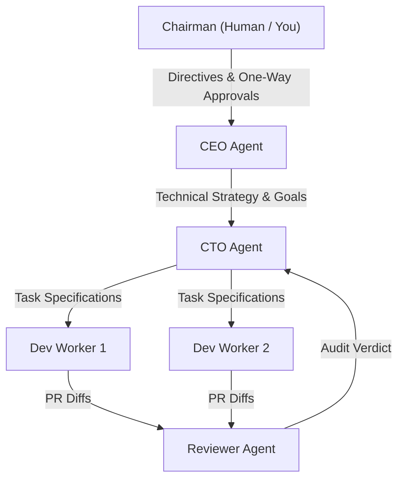
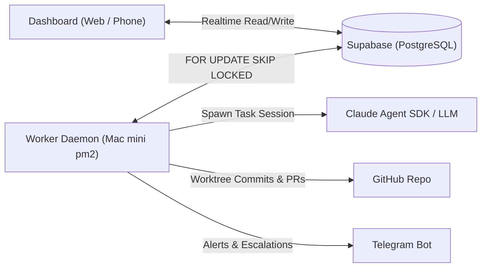

# Agentic Company Build Plan

**Date**: Oct 1, 2026  
**Author**: @Arif Eko Pramono

---

## 1. Summary

We are building a small AI company that runs itself. The Chairman (you) gives directives and reviews results. A CEO agent plans and manages the work. A CTO agent leads developer workers who build the company's own codebase.

The first product is the company itself: its task system, worker runtime and dashboard. The starting point is the existing WorkerFlow dashboard in `worker-base`. Today that dashboard is front-end only: its workers are simulated and its data lives in browser storage. The plan turns it into a real system in 7 steps.

Three principles guide it:
- **Flat hierarchy**: At most two layers between you and the workers. Every hand-off loses detail.
- **Rules in code, not prompts**: Budgets, tool access and approval gates are enforced by the system.
- **Trust is earned**: Start with tight review and loosen it role by role.

---

## 2. Org Structure

You talk only to the CEO. The CEO talks to the CTO. The CTO assigns work to the dev workers and the reviewer. Dashed boxes are added later.

Each role is a row in the `agents` table (prompt, tools, task types, budget), so adding or removing an "employee" is a config change, not new code. Only the CEO and the CTO can create tasks; workers can only report results or ask to escalate.

---

## 3. Governance Rules

We keep only the parts of the governance framework that become enforceable rules. Board committees, career ladders, and matrix reporting are dropped.

| Rule | Source Idea | How the System Enforces It |
|---|---|---|
| **One owner per task** | DRI model | `tasks.owner_agent` is a single required field |
| **Every task has acceptance criteria** | Section 8 checklist | Task creation is refused without `acceptance_criteria` |
| **Reversible work runs on its own** | Two-way door | `door = two_way` → Running → Verifying → Done |
| **Irreversible work waits for you** | One-way door | `door = one_way` → Chairman approval column; actions blocked until approved |
| **Spending limits** | Delegation of Authority | Per-role token budget per task and per day; $0 spend without approval; no payment tools at all |
| **Tool access by role** | Least privilege | `agents.allowed_tools`; a worker never gets tools outside its list |
| **Escalation** | Escalation SLA | 2 failed attempts → CEO; CEO can't resolve → Chairman |
| **Decide and move on** | Disagree and commit | Peer review is 1 critique, max 2 rounds; the owner decides |
| **Board meeting** | Board reporting | CEO writes a weekly report: done, spent, failed, waiting on you |

### One-Way Doors to Start
- Sending email or messages outside the company.
- Publishing anything public.
- Spending money.
- Deleting data.
- Merging to the production branch (`main`).
- Changing an agent's own rules or budget.

---

## 4. Architecture and Stack

Supabase is the single source of truth. The dashboard and the workers never talk to each other directly; both read and write the same tables.

If the Mac mini goes offline, tasks wait in the queue and the dashboard keeps working. A VPS worker can join later with no redesign.

| Layer | Choice | Why |
|---|---|---|
| **Language** | TypeScript everywhere | Your core stack; one language for UI, worker, and agents |
| **Database, Realtime, Storage** | Supabase | Already used in the Tower Planner; Postgres doubles as the queue |
| **Queue** | Postgres `FOR UPDATE SKIP LOCKED` (pg-boss if needed) | No Redis to run; safe with many workers |
| **Agents** | Claude Agent SDK, one session per task | Tools, permissions, and budgets set per role |
| **Process Manager** | `pm2` on the Mac mini | Restarts crashed workers and starts them on boot |
| **Code Hosting** | GitHub, one repo | Branches and pull requests are the CTO team's output |
| **Notifications** | Telegram bot | Free, works on your phone |

---

## 5. Data Model

All company state lives in Supabase (Postgres). Agents remember nothing between runs; they read what they need from these tables.

| Table | Holds | Key Fields |
|---|---|---|
| `directives` | Your instructions to the CEO | `id`, `text`, `status`, `created_at`, `report` |
| `tasks` | Units of work | `id`, `directive_id`, `parent_task_id`, `type`, `owner_agent`, `payload`, `acceptance_criteria`, `door`, `status`, `priority`, `attempts`, `max_attempts`, `lease_until` |
| `runs` | One row per attempt | `id`, `task_id`, `agent_id`, `started_at`, `ended_at`, `exit_code`, `tokens_used`, `cost_usd`, `summary`, `result` |
| `run_logs` | Log lines streamed to the dashboard | `run_id`, `ts`, `level`, `message` |
| `artifacts` | Outputs: files, PRs, reports | `run_id`, `kind`, `url_or_path`, `label` |
| `agents` | The roles ("employees") | `id`, `role`, `reports_to`, `system_prompt`, `allowed_tools`, `task_types`, `budget`, `enabled` |
| `approvals` | One-way door requests | `task_id`, `requested_by`, `action`, `decision`, `decided_at`, `note` |
| `decisions` | Company decisions log | `id`, `date`, `decided_by`, `decision`, `reason` |
| `workers` | Running processes | `id`, `host`, `capabilities`, `last_heartbeat` |

Two documents sit beside the tables and are loaded into every agent's prompt: the **Company Handbook** (mission, rules, tone, forbidden actions) and the **Engineering Standards** (owned by the CTO). Secrets stay in each worker's `.env`, never in a payload. Logs older than 30 days are deleted; Supabase backups stay on.

---

## 6. Step-by-Step Build Plan

You and Claude build Steps 0–2 by hand, because agents need a working runtime before they can build anything. From Step 3 on, the CTO and dev workers build the rest of the company themselves, with you reviewing their pull requests.

1. **Step 0: Foundation.** Built by you with Claude.
   - Create the Supabase project and the tables in Data model.
   - Turn `worker-base` into a monorepo: `dashboard/`, `worker/`, `agents/` (role configs and prompts), `docs/` (Handbook, Engineering Standards).
   - Write the first Company Handbook.
   - Mac mini: Node, git, pm2; sleep off; auto-restart after power failure.
   - Exit: tables exist, repo is on GitHub, the Handbook is written.
2. **Step 1: Real dashboard.** Built by you with Claude.
   - Replace browser storage with Supabase reads and writes plus Realtime updates.
   - Add a Directives inbox (where you write to the CEO) and a Chairman approval column.
   - Remove the simulator and the demo data.
   - Exit: a task created on your phone shows up on the Mac within seconds.
3. **Step 2: Worker runtime.** Built by you with Claude.
   - The worker loop: claim a task (`SKIP LOCKED`), keep its lease alive, stream logs, write the run result.
   - Retries with growing waits, timeouts, and a handler registry by task type.
   - One generic handler, `agent`: runs a Claude Agent SDK session with the role's prompt, tools, and budget.
   - Run it under pm2 on the Mac mini.
   - Exit: 10 test tasks finish, including 1 forced crash that is retried correctly.
4. **Step 3: CTO and the first dev worker.** From here the agents build.
   - CTO agent: turns technical goals into small tasks with acceptance criteria and owns the Engineering Standards.
   - Dev worker: works in its own git worktree, makes a branch, writes code and tests, runs them, opens a pull request.
   - Reviewer agent: reviews every pull request against the criteria and the standards.
   - Merging to `main` is a one-way door: you approve it.
   - First assignments are improvements to the company's own code (the worker and the dashboard).
   - Exit: 5 pull requests merged with no rework from you.
5. **Step 4: CEO agent.**
   - Directive → plan → tasks assigned to the CTO (and to other heads later).
   - Daily check of open work; a weekly report to you; entries in the decisions log.
   - Exit: one directive goes from your inbox to a merged result with no hand-holding.
6. **Step 5: Guardrails and autonomy.**
   - Enforced token budgets and a cost view on the dashboard.
   - Scheduler for recurring tasks; Telegram notifications for failures and approvals.
   - A kill switch: one button pauses every agent.
   - Exit: one week running unattended with no budget overrun and no unapproved one-way action.
7. **Step 6: Grow the team.**
   - Add a QA worker and more dev workers when the queue backs up.
   - Add non-tech roles (research, content, sales) once the company's business is decided.
   - Optional: a VPS worker for jobs that must survive home power or internet outages.
   - Exit: depends on the business goal you set.

---

## 7. Risks and Guardrails

| Risk | What It Looks Like | Guardrail |
|---|---|---|
| **Runaway cost** | An agent loops, retries, or debates for hours | Hard token budget per task and per day; max 2 discussion rounds; daily cost alert |
| **Errors compound across layers** | The CEO misreads a directive and the CTO builds the wrong thing | Two layers maximum; acceptance criteria on every task; you review the CEO's plan before work starts (at first) |
| **Agents agree with each other** | The reviewer approves weak work | The reviewer gets a separate prompt that asks it to find problems; tests must pass before review |
| **Agent breaks its own system** | A dev worker edits the worker runtime and everything stops | Agents work on branches only; you approve merges; the kill switch works outside the agents' code |
| **Secrets leak** | A key ends up in a log, payload, or pull request | Secrets only in `.env`; logs scrubbed for key patterns; agents have no access to `.env` files |
| **Mac mini goes down** | Power cut or internet drop | Database in the cloud; tasks wait in the queue; pm2 restarts the worker on boot |
| **Billing and terms** | Running 24/7 bots on a personal subscription | Use an API key with a monthly spending limit set in the console |

---

## 8. Open Decisions for the Chairman

- [ ] What the company does for money after it builds itself (software products, services, content, or research).
- [ ] Monthly AI budget ceiling.
- [ ] Whether the CEO's plan needs your approval before work starts, and for how long.
- [ ] Where notifications go (Telegram, email, or both).
- [ ] Whether to keep the current vanilla JS dashboard or let the CTO move it to React in Step 3.
