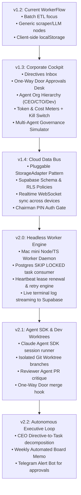

# Incremental Roadmap & Application Versions

**Document Purpose**: Step-by-step phased execution roadmap for the Agentic Company.  
**Strategy**: Start with the **Corporate Cockpit Dashboard**, prove the human-in-the-loop governance UX via rich simulation, then wire in the cloud storage bus and headless worker daemons.

---

## 🗺️ Version Progression Overview



---

## Phase 1: The Corporate Cockpit UI (Frontend Evolution)

### 📦 Version 1.3.0: Agentic Company Cockpit
**Goal**: Transform the current ETL dashboard into the executive command center for the autonomous company, complete with simulated multi-agent interactions.

- [ ] **Step 1.1: Rebrand & Layout Modernization**
  - Update branding from *WorkerFlow* to **Agentic Company Cockpit** (`v1.3.0`).
  - Introduce an executive navigation bar with quick jumps:
    - `Directives & Boardroom`
    - `Task Kanban Pipeline`
    - `One-Way Door Approvals`
    - `Agent Org & Hierarchy`
    - `Decisions & Audit Ledger`
  - Maintain the cyber-refined dark theme, glassmorphic cards, and responsive layout.

- [ ] **Step 1.2: Chairman Directives Panel (Executive Inbox)**
  - Add a dedicated view for the Chairman to draft and dispatch strategic directives to the CEO.
  - Directive status pipeline: `Draft` $\rightarrow$ `CEO Planning` $\rightarrow$ `In Execution` $\rightarrow$ `Review Ready` $\rightarrow$ `Completed`.
  - Each directive card displays:
    - Directive text and objectives.
    - Child tasks progress bar (e.g., `4/6 tasks completed`).
    - Budget allocated vs. consumed.
    - Final CEO summary report preview.

- [ ] **Step 1.3: One-Way Door / Approvals Desk**
  - Add an explicit **Chairman Approval Column / Desk** on the board.
  - Tasks flagged with `door: 'one_way'` automatically pause before executing irreversible actions:
    - Code merge to production (`main`).
    - External communication (email, Telegram, social).
    - Deploying cloud infrastructure or spending money.
    - Changing agent system prompts or budgets.
  - Clicking on a pending approval opens an **Approval Modal** featuring:
    - Detailed action proposal and blast-radius evaluation.
    - Diff viewer or payload preview.
    - Explicit buttons: `Approve Action`, `Reject / Terminate`, `Request Revision`.

- [ ] **Step 1.4: Agent Roster & Real-Time Hierarchy**
  - Replace generic worker nodes (`node-scraper-01`) with defined company agents:
    - **CEO Agent**: Strategic planning, task decomposition, resource management.
    - **CTO Agent**: Architecture specification, task assignment, technical review.
    - **Dev Worker 1 & 2**: Code implementation, test creation, git branching.
    - **Reviewer Agent**: Code critique, standards enforcement, quality audit.
  - Display agent cards showing current status (`Idle`, `Planning`, `Executing`, `Blocked`), active task lease, daily token burn, and avatar badges.

- [ ] **Step 1.5: Financial Guardrails & Kill Switch Widget**
  - Header widgets displaying:
    - **Today's Token Burn**: Real-time counter and percentage of daily limit.
    - **Estimated Cost**: Calculated in USD ($) based on token tiers.
    - **Hard Budget Ceiling**: Configurable daily stop-limit.
  - Prominent **Emergency Kill Switch** button:
    - Immediately freezes all active agent leases and prevents any new task transitions.

- [ ] **Step 1.6: Enhanced Multi-Agent Simulation Engine**
  - Upgrade the simulation engine in [app.js](file:///Users/mbp-m1-pro/Developer/Automation/agentic-company/app.js) to demonstrate the real company lifecycle:
    1. Chairman enters a directive: *"Build automated customer refund pipeline"*.
    2. CEO Agent accepts directive and spawns 3 sub-tasks with acceptance criteria.
    3. CTO Agent assigns sub-tasks to Dev Worker 1 and Dev Worker 2.
    4. Dev Workers stream simulated git commit and test execution logs.
    5. Reviewer Agent flags a one-way door approval for production deployment.
    6. System halts until Chairman clicks **Approve**.

---

## Phase 2: Cloud Data Bus & Persistence

### 📦 Version 1.4.0: Dual-Mode Persistence & Supabase Integration
**Goal**: Connect the dashboard to Supabase while preserving the ability to run offline in Demo/Simulator mode.

- [x] **Step 2.1: Storage Adapter Pattern**
  - Create a clean JavaScript repository abstraction:
    ```javascript
    class StorageAdapter {
      async getTasks() {}
      async saveTask(task) {}
      async getDirectives() {}
      async getApprovals() {}
      async logRunMessage(runId, level, message) {}
      subscribeToChanges(callback) {}
    }
    ```
  - Implement `LocalStorageAdapter` for instant offline testing and `SupabaseAdapter` for live database communication.
  - Provide a toggle in the UI: `Data Source: [Local Mock] | [Supabase Live]`.

- [x] **Step 2.2: Supabase Schema Migration Script**
  - Create a migration file (`schema.sql`) creating all 9 tables:
    - `directives`, `tasks`, `runs`, `run_logs`, `artifacts`, `agents`, `approvals`, `decisions`, `workers`.
  - Add PostgreSQL indexes on `tasks(status, lease_until)` and `run_logs(run_id, ts)`.
  - Configure Row Level Security (RLS) policies.

- [x] **Step 2.3: Realtime Subscriptions (Desktop & Mobile Sync)**
  - Integrate Supabase Realtime WebSocket listeners.
  - When the Mac mini worker updates a task or streams a log line, the UI updates without page reloads.

- [x] **Step 2.4: Chairman Access Gate**
  - Simple client-side passcode/token lock to prevent unauthorized approval actions when accessed over mobile or public tunnels.

---

## Phase 3: The Headless Worker Runtime

### 📦 Version 2.0.0: Background Task Daemon
**Goal**: Run a lightweight, resilient background worker daemon on the Mac mini that polls the database and executes tasks reliably.

- [x] **Step 3.1: Standalone Worker Daemon (`worker/`)**
  - Create a lightweight Node.js/TypeScript daemon in a `worker/` subfolder.
  - Run under `pm2` with auto-restart on system boot.

- [x] **Step 3.2: Task Queue Consumer (`SKIP LOCKED`)**
  - Implement safe queue polling using PostgreSQL:
    ```sql
    SELECT * FROM tasks 
    WHERE status = 'queued' AND lease_until <= NOW() 
    ORDER BY priority DESC, created_at ASC 
    LIMIT 1 
    FOR UPDATE SKIP LOCKED;
    ```
  - Acquire lease (`lease_until = NOW() + INTERVAL '5 minutes'`) and maintain background heartbeats every 30 seconds.

- [x] **Step 3.3: Live Log & Metric Ingestion**
  - Worker captures child process `stdout` / `stderr` and batch-inserts them into `run_logs`.
  - Update `runs` with duration, exit codes, and memory usage.

- [x] **Step 3.4: Deterministic Task Handlers & Crash Recovery**
  - Implement deterministic handlers: shell script executor, git fetcher, file generator.
  - Test crash resilience: simulate power outage or `SIGKILL`, verify task is released and retried after lease expiry.

---

## Phase 4: Autonomous Roles & Safe Coding Pipeline

### 📦 Version 2.1.0: Claude Agent SDK & Isolated Worktrees
**Goal**: Enable developer agents to safely clone, branch, write code, run tests, and open GitHub PRs without corrupting the local development environment.

- [x] **Step 4.1: Claude Agent SDK Wrapper**
  - Build a generic task runner powered by the Claude Agent SDK (or Gemini Structured Tools).
  - Inject role-specific system prompts (`Company Handbook`, `Engineering Standards`).
  - Restrict tools strictly per agent:
    - Dev Worker: `readFile`, `writeFile`, `runTest`, `gitCommit`.
    - Reviewer: `readDiff`, `runLinter`, `postReviewComment`.

- [x] **Step 4.2: Isolated Git Worktree Management**
  - Workers run inside dedicated temporary git worktrees (`.worktrees/task-XYZ`).
  - Guarantees that parallel worker tasks never clash on branch state or uncommitted files.

- [x] **Step 4.3: Automated Test Verification & Reviewer Critique**
  - Dev Worker is required to execute local test suites before completing work.
  - Reviewer agent automatically analyzes the PR diff against task `acceptance_criteria` and provides a score.

- [x] **Step 4.4: One-Way Door Merge Hook**
  - Merging a PR into `main` requires Chairman approval via the dashboard.
  - Once Chairman clicks **Approve**, the worker daemon triggers `git merge` or GitHub API merge.

---

## Phase 5: The Autonomous Loop

### 📦 Version 2.2.0: CEO Planning & Mobile Alerting
**Goal**: Complete the loop where high-level directives turn into deployed software with automated reporting.

- [x] **Step 5.1: CEO Decomposition Engine**
  - CEO agent listens for new `directives`.
  - Breaks directives down into technical specifications and populates `tasks` assigned to the CTO.

- [x] **Step 5.2: Automated Weekly Board Memo & Decision Ledger**
  - Every Friday, the CEO agent aggregates runs, tokens spent, completed PRs, and blockers into an executive report in `artifacts`.

- [x] **Step 5.3: Telegram Bot for Chairman Approvals**
  - Simple Telegram bot running on the Mac mini.
  - Sends immediate push notifications when a task lands in `One-Way Door Pending`.
  - Chairman can reply `/approve <task_id>` directly from mobile.

- [x] **Step 5.4: Automated Circuit Breakers**
  - Hard daily spending limits shut off worker polling if token consumption exceeds the configured dollar cap.
